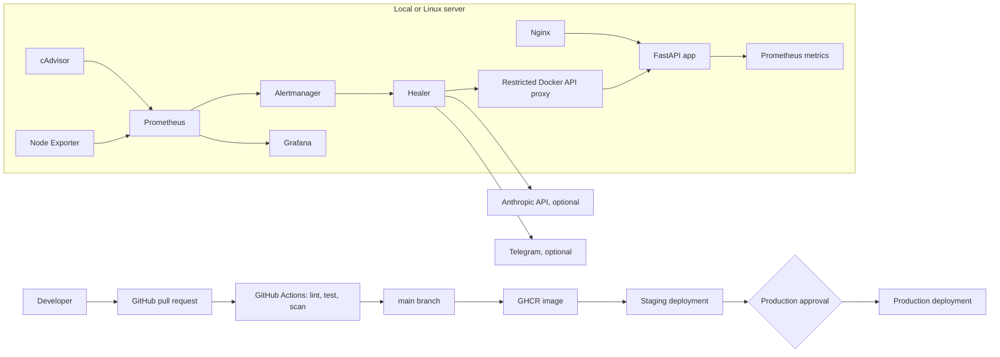

# VedaOps: self-healing server

[](https://github.com/ThushanDev/VedaOps-Self-Healing-Server_-DevOps-Project/actions/workflows/ci.yml)


**Diagnose. Heal. Tell you.**

VedaOps watches your containers, finds why they fell, and heals them safely. It packages a small API, monitors it with Prometheus, routes incidents through Alertmanager, and lets a constrained healer diagnose failures and request safe recovery.

Target GitHub repository: [ThushanDev/VedaOps-Self-Healing-Server_-DevOps-Project](https://github.com/ThushanDev/VedaOps-Self-Healing-Server_-DevOps-Project)

For the responsive web dashboard and Docker setup, see [the dashboard guide](docs/dashboard.md).

## What is included

- FastAPI demo API with `/health` and Prometheus `/metrics` endpoints.
- Docker Compose stack with Nginx, Prometheus, Alertmanager, cAdvisor, Node Exporter, Grafana, and the healer.
- A pre-provisioned Grafana dashboard and container down, high memory, HTTP error rate, and cAdvisor availability alerts.
- An Alertmanager webhook healer with container and action allowlists, secret redaction, one AI call per minute, a restart limit, and human-review fallbacks.
- GitHub Actions CI for linting, unit tests, image builds, Trivy vulnerability scans, and Gitleaks.
- GHCR publishing and optional staging then manually approved production deployment workflows.
- Windows PowerShell and Bash scripts for smoke checks and a guarded chaos demo.

## Architecture



## Run locally on Windows

Prerequisites: Docker Desktop using Linux containers, with Docker Compose enabled. Open PowerShell in the project folder. If Windows blocks local PowerShell scripts, run `Set-ExecutionPolicy -Scope Process -ExecutionPolicy Bypass` in that terminal; it applies only to that PowerShell process.

```powershell
if (-not (Test-Path .env)) { Copy-Item .env.example .env }
docker compose up --build -d
docker compose ps
Invoke-RestMethod http://127.0.0.1:8080/health
```

The health endpoint should return `status: ok`. Open these local-only pages:

- App: `http://127.0.0.1:8080/`
- Grafana: `http://127.0.0.1:3000/` (default local login `admin` / `change-me-before-deploy`)
- Prometheus: `http://127.0.0.1:9090/targets`

The dashboard appears in Grafana under the **VedaOps** folder. Change the Grafana password in `.env` before exposing any host to another network. Prometheus and Grafana bind to loopback by default.

Optional integrations are disabled until configured. Set `ANTHROPIC_API_KEY` to enable AI diagnosis; set `TELEGRAM_BOT_TOKEN` and `TELEGRAM_CHAT_ID` to enable Telegram messages. Without those values, incidents are recorded in the healer logs and the safe action is `notify_human`. An Anthropic API key can incur usage charges, so set an account spending limit before enabling it.

See [docs/integrations.md](docs/integrations.md) for safe credential setup and Telegram chat ID lookup.

For a free hosted Grafana dashboard without a VPS, see [Grafana Cloud setup](docs/grafana-cloud.md). The local Prometheus stack sends metrics to Grafana Cloud only when its opt-in Compose profile is enabled.

Stop the stack with:

```powershell
docker compose down
```

Keep monitoring history and Grafana data by default. To remove those named volumes, use `docker compose down --volumes`; that permanently removes local metrics and dashboard state.

## Exercise self-healing

Start the stack and allow Prometheus to collect data for about a minute. In PowerShell:

```powershell
./scripts/chaos-kill.ps1
```

Or in Bash:

```bash
bash scripts/chaos-kill.sh
```

The scripts allow only the local demo container or the staging app container; they refuse production and all other names. Prometheus detects its disappearance, Alertmanager calls the healer, and the healer either requests a restart or notifies a human. When the API key is absent, invalid, the response is malformed, or the diagnosis is uncertain, the healer does not restart the app. With valid AI and Telegram credentials, expect a notification with the alert, cause, action, and result. Confirm the service returned with the matching local or staging health endpoint.

View recent incident summaries inside the Compose network with `GET http://healer:8000/incidents`; the healer port is deliberately not published to the host. For container logs:

```powershell
docker compose logs --tail=100 healer alertmanager prometheus
```

## Checks

Python 3.12 is needed for local checks. From the project root:

```powershell
.\scripts\verify.ps1
```

On Linux or macOS, `bash scripts/verify.sh` runs lint, unit tests, Compose validation, Prometheus and Alertmanager validation, environment-specific monitoring checks, and both image builds. GitHub Actions runs those checks plus Trivy and Gitleaks on pull requests and pushes to `main`.

## GitHub setup for the target repository

The project files are prepared locally. Use the steps in [docs/github-publishing.md](docs/github-publishing.md) to check that your local clone points to the target repository, review the changes, then create and push your own commit. Do not commit `.env`, private keys, tokens, or real credentials.

Once the project is in the target repository:

1. Set `main` as the default branch and require both `checks` and `secrets` CI jobs before merging.
2. Create GitHub Environments named `staging` and `production`. Add required reviewers to `production`.
3. On each environment, add the secrets `SSH_HOST`, `SSH_USER`, `SSH_KEY`, `SSH_FINGERPRINT`, and `DEPLOY_PATH`.
4. Set environment variable `ENABLE_STAGING_DEPLOY` to `true` to enable staging. Set `ENABLE_PRODUCTION_DEPLOY` to `true` only after staging works and production has required reviewers.
5. Prepare Linux Docker hosts for staging and production. They can share one host: staging uses isolated Compose resources and loopback ports 8081, 9091, and 3001; production uses 8080, 9090, and 3000. Each environment needs a checkout of this repository, its own `.env` file and `DEPLOY_PATH` GitHub Environment secret, a deploy user, and Docker access. Configure read-only Git access if the repository is private. The workflow renders project-specific alert rules and dashboard queries so each stack monitors its own app. Keep all monitoring ports private; only put the production app behind a TLS reverse proxy or load balancer.
6. Configure GHCR package access for the repository. Deployment logs in with the workflow token, pulls the exact commit image, starts the app, and checks `/health` on the host's loopback interface.

Deployment is disabled unless the environment variables are set. Production waits for GitHub's environment approval after staging succeeds. The workflow expects the Compose stack to be installed at `DEPLOY_PATH` first. Add a host Nginx/Caddy/Load Balancer with TLS separately before serving public traffic; the included Nginx is a local reverse proxy and does not configure certificates or a public firewall.

The deploy workflow uses immutable Git SHA image tags and checks out the exact commit that CI scanned. To roll back on a server, set `APP_IMAGE` to the previous working GHCR SHA tag for the target Compose project, then pull and recreate its `app` service and run the matching health check. Do not use `latest` as the rollback reference.

## Safety notes and limits

- The healer can only act on the explicitly configured app container name (local default `vedaops-app`); it accepts only `restart`, `ignore`, or `notify_human` actions. Automatic restarts are limited to `ContainerDown` alerts.
- Docker access goes through a socket proxy with container endpoints enabled and unrelated API groups disabled. This still grants meaningful control over containers; keep the proxy and healer on their private Compose networks.
- The healer removes common password, token, bearer, AWS access-key, and JWT formats from the last 50 log lines before a call to Anthropic. Avoid logging credentials; regex redaction cannot identify every possible secret format.
- AI output is validated. Any API error, invalid JSON, unknown action, missing API key, or restart limit results in human review.
- Restart requests are limited to three per container per hour. Rate and restart counters are in memory and reset if the healer restarts.
- cAdvisor requires privileged host visibility and varies across Docker Desktop versions. For the most representative host metrics, run the stack on a Linux Docker host and verify Prometheus targets before relying on alerts.
- CI blocks fixed critical or high Trivy findings. A new vulnerability can therefore stop a build until the base image or dependency is updated.
- The GitHub deployment workflow does not provision EC2/VPS instances, DNS, firewall rules, TLS, or paid API accounts. Configure those separately and review any cloud cost before provisioning.

Brand colors, typography, logo usage, and incident voice are documented in [docs/brand.md](docs/brand.md).

Track local verification, CI, demo evidence, and GitHub/server setup in the [release acceptance checklist](docs/acceptance-checklist.md).

## AI assistance

AI assistance was used to produce and review parts of this repository. Follow the rules for your course or organization when documenting that use.
